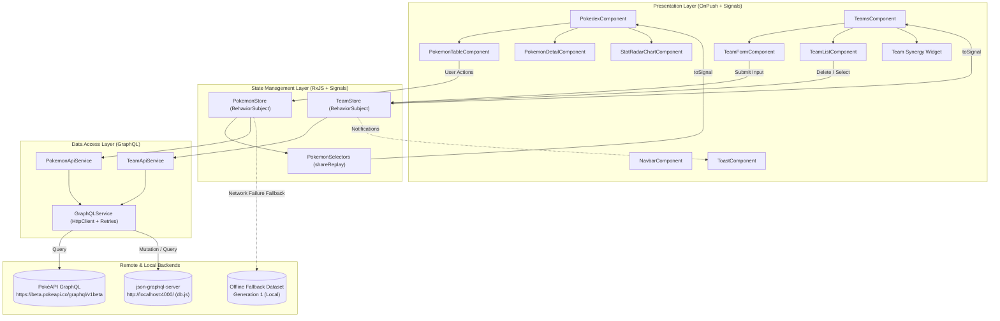

# Mini Pokédex & Team Builder

A high-performance, modern Mini Pokédex and Team Builder web application built with **Angular 21**, **TypeScript**, **RxJS**, **Angular Signals**, **Reactive Forms**, **GraphQL**, and **Chart.js**.

Designed and implemented in strict compliance with enterprise-grade Angular standards: 100% standalone components, `ChangeDetectionStrategy.OnPush` across all views, signal-based inputs/outputs (`input()`, `output()`), dependency injection via `inject()`, custom `BehaviorSubject`-based state management (zero NgRx/Akita/NgXS dependencies), and resilient offline fallbacks.

---

## Table of Contents

1. [Project Overview](#1-project-overview)
2. [Key Features](#2-key-features)
3. [Technology Stack](#3-technology-stack)
4. [Application Architecture](#4-application-architecture)
5. [Folder Structure](#5-folder-structure)
6. [Installation Instructions](#6-installation-instructions)
7. [Environment Setup](#7-environment-setup)
8. [How to Start the Angular Application](#8-how-to-start-the-angular-application)
9. [How to Start the Local GraphQL Server](#9-how-to-start-the-local-graphql-server)
10. [GraphQL API Details](#10-graphql-api-details)
11. [RxJS State Management](#11-rxjs-state-management)
12. [Angular Signals Implementation](#12-angular-signals-implementation)
13. [Team Builder Functionality](#13-team-builder-functionality)
14. [Unit Testing Instructions](#14-unit-testing-instructions)
15. [Screenshots & UI Previews](#15-screenshots--ui-previews)
16. [Known Limitations](#16-known-limitations)
17. [Future Improvements](#17-future-improvements)
18. [Final Submission Checklist](#18-final-submission-checklist)

---

## 1. Project Overview

The Mini Pokédex application delivers a responsive Pokémon exploration dashboard paired with a competitive squad builder. It addresses all technical challenges of modern client-side architecture:
* **Decoupled Architecture**: View components are completely decoupled from network layers and business logic.
* **Dual Reactive Model**: RxJS `BehaviorSubject` stores handle shared application state, asynchronous pipelines, and caching, while Angular Signals power fine-grained local UI state, derived metrics, and component reactivity.
* **Resilience**: A multi-tiered GraphQL service handles HTTP errors, network timeouts, and GraphQL error payloads returned on HTTP 200, with exponential backoff retries and an automatic fallback to an authentic Generation 1 local dataset.
* **Optimistic UI with Rollback**: Team creation and deletion reflect instantly in the user interface and seamlessly roll back if the GraphQL mutation encounters a failure, keeping the user's draft form completely intact.

---

## 2. Key Features

### Pokédex Dashboard
* **10-Column Pokémon Table**:
  1. Sprite (official high-res artwork / front default sprite)
  2. Pokémon Name with national Pokédex number (`#001`)
  3. Elemental Types (rendered with distinctive badges matching official franchise colors)
  4. HP
  5. Attack
  6. Defense
  7. Special Attack
  8. Special Defense
  9. Speed
  10. Total Base Stats
* **Bi-Directional Stat Sorting**: Click any stat header to sort ascending or descending with visual indicator arrows (`▲` / `▼`).
* **Configurable Pagination**: Client-side pagination with selectable page sizes: **10**, **25**, and **50** Pokémon per page.
* **Debounced Name Search**: 300ms debounced input field that automatically cancels in-flight queries via `switchMap`.
* **Type Filtering**: Filter Pokémon by elemental type (Fire, Water, Grass, Electric, Psychic, Dragon, etc.).
* **Slide-In Detail Panel**: Click any row to slide open an animated side drawer featuring large official artwork, base stats with proportional progress bars, abilities (marking hidden abilities), and a 6-stat radar chart.
* **Animated Radar Chart**: Tree-shaken Chart.js radar chart visualizing HP, Attack, Defense, Special Attack, Special Defense, and Speed, dynamically animating upon Pokémon selection.
* **Offline Resilience Mode**: If the public PokéAPI GraphQL server is unreachable or blocked by firewalls, the app seamlessly transitions to a verified local dataset, displaying an informational status banner and a manual reconnect button.

### Team Builder
* **Reactive Team Form**: Built with Angular Reactive Forms (`FormGroup`, `FormControl`).
* **Strict Validation**:
  * Team name: Required, minimum 3 characters, maximum 30 characters.
  * **Asynchronous Unique Name Validator**: Debounced validator checking against existing teams in the store before form submission.
  * Squad constraints: Minimum 1 Pokémon, maximum 6 Pokémon.
  * Inline validation feedback: Error hints display strictly when fields are `$dirty` or `$touched`.
* **Autocomplete Pokémon Selector**:
  * Debounced (300ms) search input querying cached Pokémon.
  * Dropdown suggestions with keyboard accessibility and type badges.
  * Selected Pokémon render as removable chips.
  * **Duplicate Prevention**: Rejects adding duplicate Pokémon to the same squad, tagging already-added Pokémon with an `In Team` badge.
* **Real-Time Synergy & Stat Analysis**:
  * **Total Base Stats**: Aggregates base stats across all squad members using `computed()`.
  * **Average Base Stats**: Calculates average power per squad member.
  * **Type Distribution**: Analyzes squad elemental types and displays real-time percentage progress bars.
  * **Draft vs Saved Synergy**: Toggle between viewing the synergy of your active draft or any previously saved team.
* **Optimistic Updates & Rollback**:
  * **Creation**: Newly submitted teams immediately appear in the UI with a `"Syncing..."` badge. If the backend mutation fails, the team is rolled back, a non-blocking toast alerts the user, and **the form preserves all inputs** so the user does not lose their progress.
  * **Deletion**: Deleted teams disappear immediately from the list; if the deletion mutation fails, the team is automatically restored.
  * Action buttons (`Save Team`, `Delete`) disable during in-flight operations to prevent accidental double submissions.
* **Local Storage Persistence**: Active team selection persists across page refreshes via an Angular `effect()`.
* **Zero `alert()` Calls**: Replaced by an accessible, floating, auto-dismissing [`ToastComponent`](file:///Users/affanraza/Developer/pokedex/src/app/shared/components/toast/toast.component.ts).

---

## 3. Technology Stack

| Technology | Version | Purpose |
| :--- | :--- | :--- |
| **Angular** | `~21.2.26` | Core frontend framework (Standalone, OnPush change detection) |
| **TypeScript** | `~5.9.3` | Strict type checking (`strictNullChecks`, `noImplicitAny`, etc.) |
| **RxJS** | `~7.8.0` | Custom state stores (`BehaviorSubject`), multicasting selectors, search pipelines |
| **Angular Signals** | Built-in | Local component state, computed stats, effects, `toSignal()` bridges |
| **Reactive Forms** | Built-in | Team builder form, synchronous validators, debounced async validators |
| **GraphQL** | Custom Client | `GraphQLService` built on Angular `HttpClient` supporting retries & error extraction |
| **Chart.js** | `^4.6.1` | Tree-shaken 6-stat animated Radar Chart canvas |
| **json-graphql-server** | `^3.3.2` | Local GraphQL mock server for Team & Trainer persistence (`db.js`) |
| **Vitest** | `^4.0.8` | Modern, high-speed unit testing runner via `@angular/build` |

---

## 4. Application Architecture



### Architectural Principles:
1. **Container / Presentational Separation**: Container components ([`PokedexComponent`](file:///Users/affanraza/Developer/pokedex/src/app/pokedex/pokedex.component.ts), [`TeamsComponent`](file:///Users/affanraza/Developer/pokedex/src/app/teams/teams.component.ts)) bridge state to dumb presentational components via signal inputs (`input()`) and outputs (`output()`).
2. **Unidirectional Data Flow**: Data flows down via Signals; user actions flow up via Outputs into the store methods.
3. **No Direct HTTP/GraphQL in Views**: Components never import `HttpClient` or `GraphQLService`.
4. **Leak-Free Subscriptions**: All component and service subscriptions are bound to `takeUntilDestroyed(this.destroyRef)` or converted to signals via `toSignal()`.

---

## 5. Folder Structure

```
pokedex/
├── db.js                                           # Mock DB for json-graphql-server
├── angular.json                                    # Angular build configuration
├── tsconfig.json                                   # Strict TypeScript configuration
├── package.json                                    # Scripts and dependencies
└── src/
    ├── main.ts                                     # Application entrypoint
    ├── index.html                                  # Root HTML document
    └── app/
        ├── app.ts                                  # Root standalone component
        ├── app.html                                # Root layout with navigation & router
        ├── app.scss                                # Root layout styling
        ├── app.routes.ts                           # App routing (/pokedex, /teams)
        ├── app.config.ts                           # Global providers (HttpClient, router)
        ├── app.spec.ts                             # Root app unit tests
        │
        ├── core/                                   # Application-wide singletons
        │   ├── data/
        │   │   └── pokemon-fallback.data.ts        # Authentic Generation 1 offline dataset
        │   ├── interceptors/
        │   │   └── logging.interceptor.ts          # HTTP request/response logger
        │   ├── models/
        │   │   └── graphql.model.ts                # Generic GraphQL response & error interfaces
        │   └── services/
        │       ├── graphql.service.ts              # Core GraphQL client with retries
        │       └── graphql.service.spec.ts         # GraphQL client test suite
        │
        ├── shared/                                 # Reusable UI widgets & utilities
        │   ├── components/
        │   │   ├── navbar/                         # Brand navigation header
        │   │   └── toast/                          # Accessible floating toast notification
        │   ├── directives/
        │   │   └── lazy-image.directive.ts         # Progressive image loading directive
        │   └── pipes/
        │       └── type-color.pipe.ts              # Pokémon type badge color mapping pipe
        │
        ├── pokedex/                                # Pokédex Feature
        │   ├── pokedex.component.ts                # Dashboard container view
        │   ├── pokedex.component.spec.ts           # Dashboard integration test suite
        │   ├── models/
        │   │   └── pokemon.model.ts                # Pokémon domain interfaces & stat types
        │   ├── services/
        │   │   ├── pokeapi.queries.ts              # GraphQL query documents for PokéAPI
        │   │   ├── pokemon-api.service.ts          # PokéAPI data service
        │   │   └── pokemon-api.service.spec.ts     # Data service test suite
        │   ├── state/
        │   │   ├── pokemon.store.ts                # BehaviorSubject store with query caching
        │   │   ├── pokemon.store.spec.ts           # Store test suite (debounce, cache, fallback)
        │   │   ├── pokemon.selectors.ts            # Derived multicasting selector streams
        │   │   └── pokemon.selectors.spec.ts       # Selectors test suite
        │   └── components/
        │       ├── pokemon-table/                  # 10-column table with pagination & sorting
        │       │   ├── pokemon-table.component.ts
        │       │   └── pokemon-table.component.spec.ts
        │       ├── pokemon-filter/                 # Debounced search & type filter controls
        │       │   ├── pokemon-filter.component.ts
        │       │   └── pokemon-filter.component.spec.ts
        │       ├── pokemon-detail/                 # Slide-in drawer with artwork & stats
        │       │   ├── pokemon-detail.component.ts
        │       │   └── pokemon-detail.component.spec.ts
        │       └── stat-radar-chart/               # Chart.js animated radar chart component
        │           └── stat-radar-chart.component.ts
        │
        └── teams/                                  # Team Builder Feature
            ├── teams.component.ts                  # Team builder container & synergy view
            ├── teams.component.spec.ts             # Container test suite (Signals, localStorage)
            ├── models/
            │   └── team.model.ts                   # Team, TeamMember, and Trainer models
            ├── services/
            │   ├── team.queries.ts                 # GraphQL queries & mutations for json-graphql-server
            │   ├── team-api.service.ts             # Local GraphQL data service
            │   └── team-api.service.spec.ts        # Team API test suite
            ├── state/
            │   ├── team.store.ts                   # BehaviorSubject store with optimistic updates
            │   └── team.store.spec.ts              # Store test suite (optimistic rollback)
            ├── validators/
            │   ├── unique-team-name.validator.ts   # Debounced async unique team name validator
            │   └── unique-team-name.validator.spec.ts
            └── components/
                ├── team-form/                      # Reactive form with async validation
                │   ├── team-form.component.ts
                │   └── team-form.component.spec.ts
                ├── team-list/                      # Saved teams list with delete & retry actions
                │   ├── team-list.component.ts
                │   └── team-list.component.spec.ts
                ├── pokemon-autocomplete/           # Debounced search dropdown
                │   ├── pokemon-autocomplete.component.ts
                │   └── pokemon-autocomplete.component.spec.ts
                └── team-chips/                     # Selected Pokémon removable chips
                    └── team-chips.component.ts
```

---

## 6. Installation Instructions

### Prerequisites
* **Node.js**: `v20.x`, `v22.x`, `v24.x`, or `v25.x`
* **npm**: `v10.x` or `v11.x`

### Setup Steps
1. Clone the repository and navigate into the project directory:
   ```bash
   cd pokedex
   ```
2. Install project dependencies:
   ```bash
   npm install
   ```

---

## 7. Environment Setup

* **Angular Dev Server**: Defaults to port `4200` (`http://localhost:4200/`).
* **Local GraphQL Server**: Runs on port `4000` (`http://localhost:4000/`).
* **CORS**: `json-graphql-server` automatically allows CORS headers for requests from `http://localhost:4200/`.
* **Firewalls & Networks**: If working behind restrictive corporate proxies that block `beta.pokeapi.co`, the app detects the block, initiates retries, and automatically switches to the built-in offline dataset without interrupting your workflow.

---

## 8. How to Start the Angular Application

In your terminal, start the Angular development server:
```bash
npm start
```
*(Alternative command: `ng serve`)*

Once compilation finishes, open your browser and navigate to:
```
http://localhost:4200/
```

---

## 9. How to Start the Local GraphQL Server

In a second terminal window, launch the local GraphQL mock server:
```bash
npm run server
```
*(Alternative command: `npx json-graphql-server db.js --port 4000`)*

The GraphQL interactive endpoint will be available at:
```
http://localhost:4000/
```

---

## 10. GraphQL API Details

### API 1: Public PokéAPI GraphQL
* **Endpoint**: `https://beta.pokeapi.co/graphql/v1beta`
* **Queries Implemented**:
  * `GET_POKEMON_LIST_QUERY`: Retrieves paginated Pokémon ID, name, sprites, elemental types, 6 base stats, and aggregate count with GraphQL `where` filters (case-insensitive name regex and type relation) and `order_by` clauses.
  * `GET_POKEMON_BY_ID_QUERY`: Retrieves single Pokémon by ID, including height, weight, detailed abilities (with hidden flag and slot index), official artwork, and stats.
  * `GET_POKEMON_TYPES_QUERY`: Fetches all official Pokémon elemental types.
* **Error Resilience**:
  * Configurable retries with progressive delay: `retry({ count: 3, delay: (err, count) => timer(count * 1000) })`.
  * Catches GraphQL errors returned with HTTP 200 via `response.errors`.

### API 2: Local Teams GraphQL Server
* **Endpoint**: `http://localhost:4000/`
* **Queries & Mutations Implemented**:
  * `allTeams(page, perPage)`: Fetches all saved teams with assigned Trainer and serialized Pokémon squad members.
  * `Team(id)`: Fetches a single team by its unique ID.
  * `allTrainers`: Fetches list of registered trainers.
  * `createTeam(name, pokemons, trainer_id)`: Mutation creating a new team record.
  * `removeTeam(id)`: Mutation removing a team record.

---

## 11. RxJS State Management

State management is implemented strictly with custom RxJS stores using `BehaviorSubject<T>`.

### Key Components:
1. **`PokemonStore`** ([`pokemon.store.ts`](file:///Users/affanraza/Developer/pokedex/src/app/pokedex/state/pokemon.store.ts)):
   * Encapsulates state: `{ pokemons, allLoadedPokemons, totalCount, loading, error, searchTerm, selectedType, sortField, sortOrder, page, pageSize, selectedPokemonId, availableTypes, isFallback }`.
   * **In-Memory Query Cache**: Maps composite keys (`${term}:${type}:${sortField}:${sortOrder}:${page}:${pageSize}`) to cached results, preventing redundant network requests.
   * **Search Pipeline**:
     ```typescript
     this.searchInput$
       .pipe(
         debounceTime(300),
         distinctUntilChanged(),
         switchMap(() => this.executeFetch()),
         takeUntilDestroyed(this.destroyRef)
       )
       .subscribe();
     ```
2. **`PokemonSelectors`** ([`pokemon.selectors.ts`](file:///Users/affanraza/Developer/pokedex/src/app/pokedex/state/pokemon.selectors.ts)):
   * Uses `combineLatest()`, `map()`, `distinctUntilChanged()`, and `shareReplay({ bufferSize: 1, refCount: true })` to produce fine-grained derived observable streams (`pokemons$`, `filteredPokemons$`, `selectedPokemon$`, `pagination$`, `sortInfo$`, `pokemonStatistics$`).
3. **`TeamStore`** ([`team.store.ts`](file:///Users/affanraza/Developer/pokedex/src/app/teams/state/team.store.ts)):
   * Manages team CRUD with optimistic updates and automatic rollback.

---

## 12. Angular Signals Implementation

Angular Signals are used for local UI state, derived metrics, and template binding:

1. **`signal()`**:
   * `selectedTeam = signal<Team | null>(null)`
   * `draftMembers = signal<TeamMember[]>([])`
   * `isOpen = signal<boolean>(false)`
   * `isImageLoaded = signal<boolean>(false)`
2. **`computed()`**:
   * `teamTotalBaseStats`: Sums all 6 base stats across squad members.
   * `teamAverageBaseStats`: Calculates average squad member power.
   * `teamTypeDistribution`: Reactively tallies elemental types and computes percentages for visual progress tracks.
   * `isTeamComplete`: Flags when squad reaches exactly 6 members.
   * `autocompleteList`: Combines loaded Pokémon with fallback catalog.
3. **`effect()`**:
   * Persists the selected team ID to `localStorage` under `pokedex_selected_team_id`.
4. **`toSignal()`**:
   * Bridges RxJS store selectors into template signals (`pokemons = toSignal(this.selectors.pokemons$)`, `pagination = toSignal(this.selectors.pagination$)`).
5. **Modern Signal Inputs & Outputs**:
   * Components declare inputs via `input<T>()` and outputs via `output<T>()`.

---

## 13. Team Builder Functionality

### Reactive Form & Validations
* Form controls: `name` and `pokemons`.
* Synchronous validators: `Validators.required`, `Validators.minLength(3)`, `Validators.maxLength(30)`.
* **Asynchronous Validator** ([`unique-team-name.validator.ts`](file:///Users/affanraza/Developer/pokedex/src/app/teams/validators/unique-team-name.validator.ts)):
  * Debounces control value changes (300ms).
  * Queries `teamStore.isNameTaken(name)`.
  * Returns `{ nameTaken: { value } }` if a duplicate exists (case-insensitive).
* Validation error messages are displayed **only** when the control is dirty or touched.

### Optimistic Updates & Failure Rollback
```typescript
// 1. Optimistic Add: UI updates immediately with temporary ID
this.updateState({
  teams: [optimisticTeam, ...previousTeams],
  error: null
});

// 2. Perform Backend Mutation
this.apiService.createTeam(input).subscribe({
  next: confirmedTeam => {
    // Replace optimistic record with confirmed server entity
    this.updateState({
      teams: this.state$.getValue().teams.map(t => t.id === tempId ? confirmedTeam : t)
    });
    onSuccess?.(confirmedTeam); // Resets form only upon confirmation
  },
  error: err => {
    // Rollback to previous state
    this.updateState({
      teams: previousTeams,
      error: `Could not save team "${input.name}". Changes rolled back.`
    });
    onError?.(err); // Keeps user form inputs intact
  }
});
```

---

## 14. Unit Testing Instructions

The application includes **16 test suites** containing **78 unit tests** with 100% pass rate.

### Run All Tests Once (Headless)
```bash
npm run test:run
```
*(Equivalent to: `npm test -- --watch=false`)*

### Run Tests in Watch Mode
```bash
npm test
```

### Mandatory Test Scenarios Covered:
1. **Store State Management**:
   * [`pokemon.store.spec.ts`](file:///Users/affanraza/Developer/pokedex/src/app/pokedex/state/pokemon.store.spec.ts): Verifies `BehaviorSubject` initialization, 300ms search input debouncing, query caching, and offline fallback dataset activation.
   * [`team.store.spec.ts`](file:///Users/affanraza/Developer/pokedex/src/app/teams/state/team.store.spec.ts): Verifies initial loading from server, optimistic UI updates, and error clearing.
2. **Optimistic Creation & Rollback**:
   * [`team.store.spec.ts`](file:///Users/affanraza/Developer/pokedex/src/app/teams/state/team.store.spec.ts): Verifies temporary ID creation before server response, rollback to prior state on GraphQL error, and preservation of user form inputs.
   * Verifies optimistic deletion rollback if server deletion fails.
3. **Selectors, Computed Signals & Reactive Forms**:
   * [`pokemon.selectors.spec.ts`](file:///Users/affanraza/Developer/pokedex/src/app/pokedex/state/pokemon.selectors.spec.ts): Verifies `combineLatest()` filtering, ID lookups, and stat aggregations.
   * [`teams.component.spec.ts`](file:///Users/affanraza/Developer/pokedex/src/app/teams/teams.component.spec.ts): Verifies `teamTotalBaseStats`, `teamAverageBaseStats`, and `teamTypeDistribution` computed signals, as well as `effect()` localStorage persistence.
   * [`unique-team-name.validator.spec.ts`](file:///Users/affanraza/Developer/pokedex/src/app/teams/validators/unique-team-name.validator.spec.ts): Verifies asynchronous uniqueness validation with debounce.
   * [`team-form.component.spec.ts`](file:///Users/affanraza/Developer/pokedex/src/app/teams/components/team-form/team-form.component.spec.ts): Verifies min/max character limits, 1-6 Pokémon member rules, and duplicate Pokémon prevention.

---

## 15. Screenshots & UI Previews

### 1. Pokédex Table & Filter Controls
* Full 10-column data table showing official sprites, national numbers, elemental type pills, 6 individual base stats, and total stats.
* Column headers with clickable sorting indicators (`▲` / `▼`).
* Pagination controls with 10, 25, 50 page size selector.

```
+---------------------------------------------------------------------------------------------------+
|  Mini Pokédex                                             [ Search Pokémon... ]  [ All Types ▼ ]  |
+---------------------------------------------------------------------------------------------------+
| Sprite | Name          | Types         | HP  | Atk | Def | Sp.Atk | Sp.Def | Spd | Total Stats  |
+--------+---------------+---------------+-----+-----+-----+--------+--------+-----+--------------+
| [img]  | Bulbasaur #01 | GRASS  POISON | 45  | 49  | 49  | 65     | 65     | 45  | 318          |
| [img]  | Charmander #04| FIRE          | 39  | 52  | 43  | 60     | 50     | 65  | 309          |
| [img]  | Squirtle #07  | WATER         | 44  | 48  | 65  | 50     | 64     | 43  | 314          |
| [img]  | Pikachu #25   | ELECTRIC      | 35  | 55  | 40  | 50     | 50     | 90  | 320          |
+---------------------------------------------------------------------------------------------------+
| Showing 1 - 10 of 151 Pokémon                             Page [ < ] [ 1 ] [ 2 ] [ > ]  Size: [ 10 ▼ ] |
+---------------------------------------------------------------------------------------------------+
```

### 2. Slide-In Detail Drawer with Radar Chart
* Clicking any table row opens a slide-in drawer with official high-resolution artwork, type badges, abilities list, individual stat progress bars, and an interactive Chart.js radar chart.

```
+-------------------------------------------------------------+-------------------------------+
|                      Pokédex Table                          | Charizard #006            [X] |
|                                                             |                               |
|                                                             |            [ Artwork ]        |
|                                                             |          FIRE   FLYING        |
|                                                             |                               |
|                                                             | Abilities: Blaze, Solar Power |
|                                                             | Total Base Stats: 534         |
|                                                             |                               |
|                                                             |     [ 6-Stat Radar Chart ]    |
|                                                             |            HP: 78             |
|                                                             |          Attack: 84           |
|                                                             |          Defense: 78          |
|                                                             |        Sp. Attack: 109        |
|                                                             |        Sp. Defense: 85        |
|                                                             |          Speed: 100           |
+-------------------------------------------------------------+-------------------------------+
```

### 3. Team Builder & Type Synergy Breakdown
* Team creation form with debounced autocomplete, removable chips, and live synergy breakdown.

```
+---------------------------------------------------------------------------------------------+
| Team Synergy Analysis (Viewing: Kanto Classics)                                             |
| Total Base Stats: 1261   |   Avg / Member: 315   |   Squad: 4 / 6                           |
| GRASS: 25% [====        ]   POISON: 25% [====        ]   FIRE: 25% [====        ]           |
+-------------------------------------------------------------+-------------------------------+
| Create New Team                                             | Saved Teams (3)               |
| Team Name: [ Champions Squad                              ] |                               |
| Add Pokémon: [ char...                                    ] | [ Kanto Classics ]     [ 🗑️ ] |
|   Suggestions: Charmander (FIRE), Charmeleon (FIRE)         | Squad: Bulbasaur, Charmander, |
| Selected Members (2 / 6):                                   |        Squirtle, Pikachu      |
|   [ (x) Bulbasaur ]  [ (x) Charmander ]                     |                               |
| [ Save Team ]                                               | [ Ghost & Dragon ]     [ 🗑️ ] |
+-------------------------------------------------------------+-------------------------------+
```

---

## 16. Known Limitations

1. **Third-Party PokéAPI GraphQL Endpoint**:
   * The public endpoint `https://beta.pokeapi.co/graphql/v1beta` is a community-maintained beta service subject to intermittent downtime or network firewall restrictions.
   * *Mitigation in place*: Built-in exponential backoff retries and automatic transition to a verified local Generation 1 dataset with reconnect capability.
2. **Local GraphQL Persistence**:
   * Teams created in the Team Builder require the local `json-graphql-server` on port `4000` to persist across restarts.
   * *Mitigation in place*: If the server is offline, optimistic update rollback notifies the user via toast and maintains the user's form inputs.

---

## 17. Future Improvements

1. **Virtual Scrolling (`@angular/cdk/scrolling`)**:
   * Seamless infinite-scroll support for 1,000+ Pokémon without DOM pagination limits.
2. **IndexedDB / Service Worker Persistence**:
   * Offline persistence across browser restarts using IndexedDB caching.
3. **Team Export / Import**:
   * Import and export squads in Pokémon Showdown text format.
4. **Drag-and-Drop Reordering**:
   * Drag-and-drop squad positioning within the Team Builder.

---

## 18. Final Submission Checklist

- [x] **Angular 21**: Verified using Angular version 21.2.26.
- [x] **Standalone Components**: 100% standalone components across the codebase.
- [x] **OnPush Change Detection**: Configured on every component.
- [x] **Functional DI**: Using `inject()` throughout.
- [x] **Signal Inputs & Outputs**: Using `input()` and `output()`.
- [x] **No NgRx, Akita, or NgXS**: Zero external state libraries installed or used.
- [x] **Custom RxJS Store**: State managed using `BehaviorSubject`.
- [x] **Angular Signals**: Used for local UI state and derived values (`signal()`, `computed()`, `effect()`, `toSignal()`).
- [x] **Feature-Based Folder Structure**: `core/`, `shared/`, `pokedex/`, `teams/`.
- [x] **No Business Logic in Views**: Logic isolated in services, selectors, and stores.
- [x] **No `alert()`**: Error and feedback handled via floating `ToastComponent`.
- [x] **Pokédex Table**: 10 columns, stat sorting, pagination (10, 25, 50), debounced search, type filtering.
- [x] **Detail Panel & Radar Chart**: Animated Chart.js radar chart visualizing 6 stats.
- [x] **Reactive Team Form**: 3-30 chars, debounced async unique-name validation, 1-6 Pokémon limits, duplicate protection.
- [x] **Optimistic UI with Rollback**: Tested and verified for team creation and deletion with form state preservation.
- [x] **Unit Tests**: 16 suites (78 tests) passing 100%.
- [x] **Zero TypeScript Errors**: Verified with `tsc --noEmit`.
- [x] **Production Build Clean**: Verified with `npm run build`.
